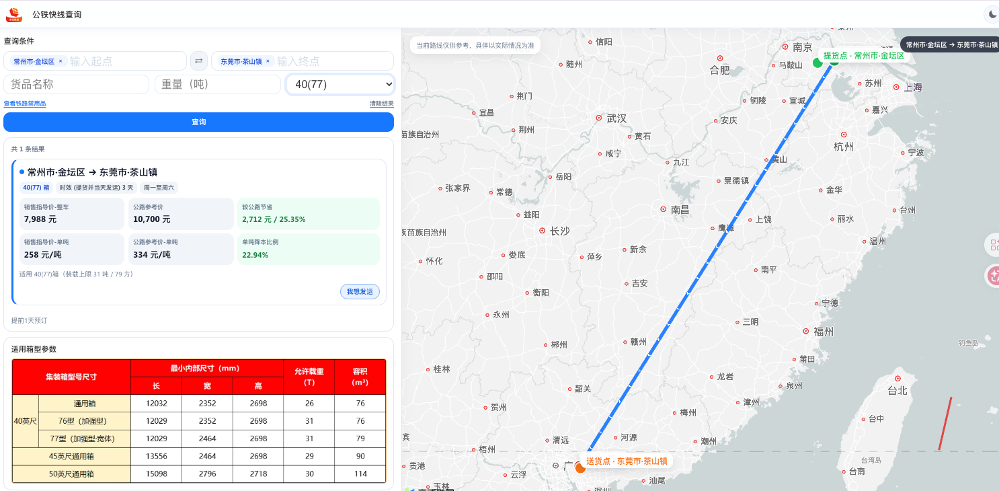

# 公铁快线自然语言查询 PRD（草稿）

**版本**：V0.4　**日期**：2026-11-04　**状态**：草稿，待确认结果、地图及 CRM 接口数据契约

## 1. 背景与本期目标

旧需求「3【ANCT-305】多式联运 公路快线查询 1期」定义了销售秘书中的固定入口和对话推荐卡片：识别公铁联运查询意图后，跳转到独立查询工具；销售秘书本身不计算报价。本次在此基础上支持自然语言发起公铁快线查询，提取查询条件，通过用户补充的主服务 Agent 接口发起对话，并在销售秘书内直接呈现查询结果与路线地图。

本 PRD 面向产品、设计、研发和测试。**本期交付范围**为自然语言查询输入、条件校验、Agent 接口对接、与所附截图对应的 PC 查询界面输出，以及从查询结果创建 CRM 线索。结果与地图在销售秘书内直接展示。地图及结果所需的结构化数据尚未在已提供接口文档中定义，不能据现有文档认定已可实现，需补齐契约。旧版固定入口和推荐卡片的既有文案、埋点、免登及多端规则不在本次改动范围内。

**依据**：用户本次说明；归档的旧需求 Word、界面截图及 `api_agent_external.md`。截图中的路线、报价、节省金额及车型参数均为界面样例，不作为生产数据或计算规则。接口文档所引用的 `api_agent.md` 等详细协议文件未提供，本文仅使用已附文档中的字段。

## 2. 查询输入

自然语言是新增输入方式。用户在销售秘书现有对话框表达需求；系统从用户表述中提取条件，并在秘书内的查询界面展示，供用户查看、补充或修改。仅有起点和终点即可发起查询。Agent 可以在同一会话的 follow up 中追问货品、重量和货箱，用户也可主动补充或调整；这三项缺失不阻断查询。

| 条件 | 必填 | 输入与识别要求 | 提交规则 |
| --- | --- | --- | --- |
| 起点 | 是 | 从自然语言或起点输入框取得地点 | 缺失或无法唯一确定时，要求用户补充或选择；未确定前不发起路线查询。地点粒度与地址解析规则 TBD。 |
| 终点 | 是 | 从自然语言或终点输入框取得地点 | 同起点。 |
| 货品名称 | 否 | 可从自然语言提取，也可在表单输入 | 未提供时不传具体货品值；货品字典、禁运校验及匹配方式 TBD。 |
| 重量（吨） | 否 | 可从自然语言提取，也可在表单输入；界面统一以吨展示 | 未提供时不传具体重量值；单位换算、数值范围和精度 TBD。 |
| 货箱 | 否 | 本期支持 **40(77)、45、50** 三种选项；从自然语言识别或在下拉框选择 | 未指定时按“全部货箱”查询，覆盖三种支持箱型，展示接口返回的各箱型可用方案；不默认选中截图中的 40(77)。 |

自然语言示意：“从常州金坛到东莞茶山，45 尺箱，货品为 XX，重 XX 吨。”此句只说明字段提取形式，不代表实际可达线路或报价。对于“从常州到东莞”之类不满足接口地点粒度的输入，具体补全与地点选择方式待接口能力确认。同一会话 follow up 中补充货品、重量或货箱后，以更新后的条件再次查询；已确定的起终点继续使用，除非用户明确修改。

## 3. 处理流程与职责

1. 用户在销售秘书现有对话入口表达公铁快线查询需求，或在秘书内的查询区填写条件。
2. 自然语言处理能力识别查询意图和第 2 节字段，将识别结果展示为可核对的查询条件。识别不确定的值不自动填入确定字段。
3. 系统校验起点、终点；需要补充时提示用户。只有这两项确定即可提交查询；未指定货箱时查询全部三种支持箱型。用户后续可补充选填条件并重新查询。
4. 销售秘书以已登录用户身份调用主服务 `POST /api/agent/chat`；同一轮澄清或追问沿用返回的 `session_id`。取得线路结果及地图所需数据的具体响应契约见 Q-01。销售秘书不自行计算、改写报价与线路运营数据。
5. 查询成功后，在销售秘书内的同一查询界面展示**结果区和地图区**；两者均为成功态必需内容。
6. 用户点击某条结果的“创建线索”，销售秘书调用 CRM 已有的智能创建线索接口，并按接口返回结果反馈创建状态；请求字段与接口契约见 Q-07。

### 3.1 接口对接的业务数据契约

已提供的 `api_agent_external.md` 确认主服务对外入口为 `POST /multimodal-transport/api/agent/chat`（下表路径前缀为 `/multimodal-transport`）。客户端须使用用户登录态；浏览器不使用服务间令牌，也不直连独立 Agent。文档提供 JSON 和 SSE 两种响应方式，本期选择哪一种 TBD。

| 已确认协议项 | 已提供文档中的字段或行为 | 本需求使用方式 |
| --- | --- | --- |
| 请求 | `message` 必填；`session_id`、`stream` 可选 | 发送用户原话；多轮继续传同一 `session_id`。是否另传表单修订值、如何组成 `message`，待联调确认。 |
| 整包响应 | `answer`、`session_id`、`intent`、`ui_tag`、`form_values` 等；`ui_tag` 可为 `Form` 或 `Result` | `Form` 可用于表单预填，`Result` 可标识结果阶段；**文档未给出路线结果对象或地图对象**，不得仅凭 `answer` 文案推断地图线路。 |
| 流式响应 | `intent`、`tool_start`、`tool_result`、`progress`、`delta`、`done`、`error` 等事件 | 若采用 SSE，以 `done` 完成当前轮次；结构化结果与地图在事件中的承载位置仍待确认。 |
| 鉴权与错误 | 须登录；未登录 401，空消息等 400，上游异常 500/502/503 | 在秘书现有登录态下发起请求；界面区分鉴权、输入与查询失败。具体提示文案 TBD。 |

下表是为完成本需求所需的**业务语义契约**，不是文档已经确认的接口字段名或格式。

| 方向 | 最小数据 | 用途与约束 |
| --- | --- | --- |
| 查询请求 | 起点、终点；可选货品、重量（吨）和指定货箱；未指定货箱时查询全部支持箱型 | 现有对外接口只定义 `message`，未定义结构化查询参数。字段传递方式、地点标识、箱型编码及“全部货箱”表达方式需与接口方确认。 |
| 查询响应·结果 | 查询状态；可展示的线路/方案列表；每条方案的起终点、箱型及由接口提供的结果信息 | 结果区只展示接口实际返回且口径明确的数据。报价、费用、节省比例、时效等字段是否存在及含义 TBD，不在前端自行推算。 |
| 查询响应·地图 | 与结果方案对应的路线定位数据，至少能标示起点、终点及路线；或接口提供可直接呈现的地图能力 | 地图与当前展示的方案必须对应；底图、坐标系、路径形态、交互能力及地图服务授权 TBD。 |

若现有 Agent 返回缺少路线和地图结构化数据，需由接口方提供扩展响应或明确的地图接口，供销售秘书渲染；本 PRD 不预设其已存在，也不指定前后端内部实现。

### 3.2 CRM 智能创建线索接口

结果卡片上的“创建线索”直接触发对现有 CRM 智能创建线索接口的调用，不另设计一套线索录入流程。点击的是哪条方案，应随创建请求关联该条方案及本次查询条件；CRM 接口所需字段、字段映射、调用端、鉴权方式、返回的线索标识和重复创建处理均待接口文档确认。接口未返回成功时，销售秘书不得显示创建成功。

## 4. 输出与界面

以截图为销售秘书内 PC 查询界面的展示参照：查询条件位于左上，结果位于左侧，地图位于右侧。货箱控件默认显示“全部货箱”，可选 40(77)、45、50；截图中的 40(77) 默认选中态不沿用。此次新增自然语言入口后，最终查询条件应与输入区一致；用户通过 follow up 或表单修改条件并重新查询时，结果和地图应对应同一次查询。对话区与查询界面的具体布局方式由设计确定，不能仍以跳转独立工具页替代本期输出。

| 区域 | 本期必须呈现的内容 | 与截图的关系 |
| --- | --- | --- |
| 查询条件 | 起点、终点、货品名称、重量（吨）、货箱；可发起查询 | 沿用截图中的条件区结构；货箱新增“全部货箱”默认态。Agent 返回 `ui_tag=Form` 及 `form_values` 可作为预填信号，字段映射待确认。 |
| 查询结果 | 至少展示本次查询返回的方案/线路结果，并能识别其起终点与所用箱型 | 截图含结果卡片、报价与节省金额等样例。哪些指标由接口提供、字段为空时的展示方式 TBD。 |
| 路线地图 | 与结果对应的起终点标记和路线展示 | 地图为成功态必需；截图的蓝色连线仅作视觉参考，不表示已确认的实际行驶路径算法。 |
| 创建线索 | 每条可操作结果的按钮文案为“创建线索” | 替换截图中的“我要发运”；点击后调用第 3.2 节接口，并在当前界面反馈接口返回的成功或失败状态。 |

截图下方的适用箱型参数表、价格计算口径与提货日期等内容属于旧界面展示。是否复用、是否由接口驱动以及数据来源均待确认；本次不据截图新增业务规则。若返回多个方案，结果与地图的选中联动、默认方案和排序规则 TBD。

## 5. 异常与边界

| 场景 | 必要处理 | 待确认口径 |
| --- | --- | --- |
| 缺少或无法确定起点/终点 | 明确指出需补充的地点；不提交不完整的查询 | 地点消歧方式、地点粒度（Q-04）。 |
| 查询接口无结果 | 不展示虚构方案或路线；说明本次未查到结果 | 空结果文案、地图保留状态（Q-05）。 |
| 查询接口失败或超时 | 不把失败当作“无线路”；告知查询未完成 | 错误文案、重试方式及超时阈值（Q-05）。 |
| 只有结果或只有地图数据 | 不能视为满足“结果＋地图”的成功态；需标示未完整返回 | 缺失数据的显示与接口责任（Q-05）。 |
| CRM 创建线索接口失败或未明确返回成功 | 不提示创建成功，保留当前查询结果与地图，提示本次创建未完成 | CRM 错误码、重试及重复创建口径（Q-07）。 |

## 6. 验收要点

以下为待执行用例；带有 TBD 的规则需在对应问题关闭后细化预期。

| ID | 输入或操作 | 可观察结果 | 依赖 |
| --- | --- | --- | --- |
| AC-01 | 自然语言同时包含可识别的起点和终点 | 条件区出现对应起终点，能够提交查询请求。 | 地点解析 Q-04 |
| AC-02 | 只给起点或只给终点 | 提示补充缺失地点，未向路线接口提交不完整请求。 | — |
| AC-03 | 只提供起终点，不提供货品、重量、货箱 | 可以进入查询流程；货箱显示“全部货箱”，请求覆盖三种支持箱型，不包含臆造的货品或重量。 | 接口表达方式 Q-03 |
| AC-04 | 提供 40(77)、45、50 中任一货箱 | 识别或选中的箱型与提交条件、结果展示一致。 | 箱型编码 Q-03 |
| AC-05 | 接口成功返回完整线路结果和地图数据 | 销售秘书内的同一查询界面同时显示结果区与对应地图，起终点一致。 | 数据契约 Q-01 |
| AC-07 | 用户在同一会话 follow up 中补充货箱、货品或重量 | 后续请求沿用 `session_id` 和未被修改的起终点；查询条件、结果及地图按更新后的条件重新对应。 | 字段映射 Q-01 |
| AC-06 | 接口返回无结果、失败或数据不完整 | 不展示编造的报价或路线；清晰区分无结果与查询失败。 | 异常口径 Q-05 |
| AC-08 | 查询结果中点击某条方案的“创建线索”，CRM 接口返回成功 | 调用 CRM 智能创建线索接口；当前界面反馈创建成功，关联的是所点击方案。 | 请求与返回契约 Q-07 |
| AC-09 | 点击“创建线索”后 CRM 接口返回失败或结果不明确 | 当前界面不显示创建成功；查询结果与地图仍可查看。 | 错误与重复创建口径 Q-07 |

## 7. 待确认事项

| 编号 | 问题 | 影响 |
| --- | --- | --- |
| Q-01 | 已提供主服务 Agent 对外接口，但 `api_agent_external.md` 未定义结果对象与地图对象。接口方能否提供这两类结构化数据？字段、地图底图/路径、返回位置及与 `ui_tag` 的对应关系是什么？是否还需要独立 Map 接口？ | 结果与地图能否在销售秘书内渲染、联调及验收。 |
| Q-02 | 已确认结果和地图在销售秘书内直接展示。对话区与查询界面的具体布局及 PC 以外客户端范围是什么？ | 页面设计和多端范围。 |
| Q-03 | 货箱为选填，未指定时查询全部三种支持箱型。三种箱型在接口中的准确编码是什么？现有 Agent 如何表达“全部货箱”并返回各箱型可用方案？ | 请求参数、结果映射及验收。 |
| Q-04 | 起终点支持到城市、区县、具体地址的哪一层级？同名地点如何消歧？重量输入范围、精度与其他单位换算口径是什么？ | 自然语言解析与表单校验。 |
| Q-05 | 无结果、超时、结果或地图数据缺失时分别如何显示？路线底图、坐标系和多方案联动规则是什么？ | 结果页状态与地图验收。 |
| Q-06 | 截图中的报价、节省金额、吨价及适用箱型参数是否属于本期必须展示项？其数据来源和口径是什么？ | 结果字段、页面范围。 |
| Q-07 | CRM 智能创建线索接口的地址、请求必填字段、当前方案与查询条件的字段映射、鉴权、成功/失败返回和重复创建规则是什么？ | 创建线索联调、成功反馈及验收。 |

以上事项确认后更新本草稿；未确认前，截图样例数字、旧版跳转规则及接口选型不作为新增功能的最终验收依据。
